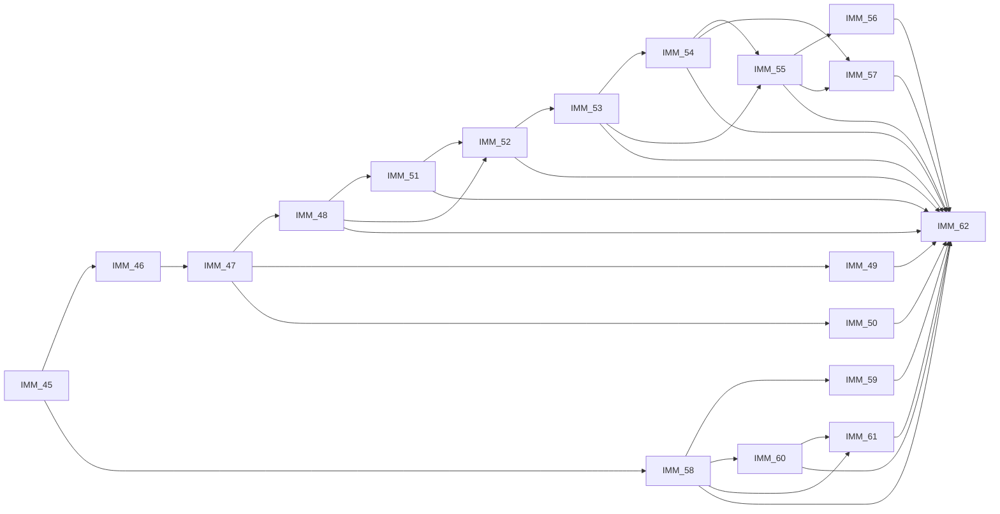

# Offline execution order

These are dependency constraints, **not** a mandatory serial schedule. Work may proceed in parallel once blockers complete.

| ID | Stage | Work item | Blocked by | Priority |
|---|---|---|---|---|
| [IMM-45](tickets/IMM-45.md) | M0 | Inspect assets and bootstrap Monocle monorepo | None | High |
| [IMM-46](tickets/IMM-46.md) | M1 | Connect Obsidian panel to independent companion | IMM-45 | High |
| [IMM-47](tickets/IMM-47.md) | M1 | Stream and cancel a Cravat execution through Copilot adapter | IMM-46 | High |
| [IMM-48](tickets/IMM-48.md) | M1 | Supply active-note context and restricted read-only vault tools | IMM-47 | High |
| [IMM-49](tickets/IMM-49.md) | M2 | Configure model, context window and thinking effort in Monocle | IMM-47 | Medium |
| [IMM-50](tickets/IMM-50.md) | M2 | Persist and resume local Monocle conversations | IMM-47 | Medium |
| [IMM-51](tickets/IMM-51.md) | M2 | Route registered deterministic commands and agentic requests | IMM-48 | High |
| [IMM-52](tickets/IMM-52.md) | M2 | Create schema-valid notes via existing Curator skill | IMM-48, IMM-51 | High |
| [IMM-53](tickets/IMM-53.md) | M3 | Persist session-scoped portable change proposals | IMM-52 | High |
| [IMM-54](tickets/IMM-54.md) | M3 | Validate and apply managed changes with risk policy | IMM-53 | High |
| [IMM-55](tickets/IMM-55.md) | M3 | Review session changes in native Obsidian diff view | IMM-53, IMM-54 | High |
| [IMM-56](tickets/IMM-56.md) | M3 | Approve all pending eligible changes in current execution session | IMM-55 | High |
| [IMM-57](tickets/IMM-57.md) | M3 | Rebase stale changes into new pending proposals | IMM-54, IMM-55 | High |
| [IMM-58](tickets/IMM-58.md) | M4 | Incrementally index synchronized notes in SQLite FTS5 | IMM-45 | High |
| [IMM-59](tickets/IMM-59.md) | M4 | Query metadata, persistent identities and explicit note relationships | IMM-58 | High |
| [IMM-60](tickets/IMM-60.md) | M4 | Add configurable optional ChromaDB semantic retrieval | IMM-58 | Medium |
| [IMM-61](tickets/IMM-61.md) | M4 | Show compact index health and expandable maintenance controls | IMM-58, IMM-60 | Medium |
| [IMM-62](tickets/IMM-62.md) | M5 | Verify Monocle MVP end to end and on second host | IMM-48, IMM-49, IMM-50, IMM-51, IMM-52, IMM-53, IMM-54, IMM-55, IMM-56, IMM-57, IMM-58, IMM-59, IMM-60, IMM-61 | High |

## Initial parallelism

- **IMM-45** is the only initially unblocked ticket.
- Once IMM-45 completes, **IMM-46** (Obsidian integration) and **IMM-58** (SQLite indexing) can run concurrently.
- Once IMM-47 completes, model settings (IMM-49) and conversation persistence (IMM-50) can run alongside active-note context work (IMM-48).
- IMM-62 joins all MVP branches and must wait for each listed predecessor.

## Mermaid dependency graph

